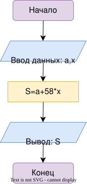

# Домашнее задание

## Условие задачи
Мальчик, продающий на улице газеты, зарабатывает **a руб.** на продаже первых **75 газет**. На каждой из остальных проданных газет он зарабатывает по **x руб.** Напишите программу, которая выведет на дисплей заработок мальчика, если он продаст **133 газеты**.

---

## 1. Алгоритм и блок-схема

### Алгоритм
1. **Начало.**
2. **Задать исходные данные:**
   * `a` — заработок за первые 75 газет (руб.).
   * `x` — заработок за каждую последующую газету (руб.).
3. **Вычислить заработок:**
   * Рассчитать общую сумму по формуле: `S = a + 58 * x`.
4. **Вывод данных:**
   * Вывести значение `S` на экран.
5. **Конец.**
### Блок-схема

[](https://viewer.diagrams.net/?tags=%7B%7D&lightbox=1&highlight=0000ff&edit=_blank&layers=1&nav=1&dark=auto#R%3Cmxfile%3E%3Cdiagram%20name%3D%22%D0%A1%D1%82%D1%80%D0%B0%D0%BD%D0%B8%D1%86%D0%B0-1%22%20id%3D%22vYnkC4cLGcOmQwEQ1W34%22%3E7Zhbb5swFMc%2FDS%2BTWoHNLY9N0nWTOqlapG59dOEQrBmMjNOQffoZMOGWLpc13ar1xfE5to%2Fh%2FP4HHAw8S4obQbL4Cw%2BBGcgMCwPPDYQs27LVT%2BnZ1B7PxrVjKWioJ7WOBf0J2mlq74qGkPcmSs6ZpFnfGfA0hUD2fEQIvu5Pizjr75qRJYwci4CwsfcbDWVce33ktf5PQJdxs7PlTuqRhDST9Z3kMQn5uuPC1waeCc5l3UuKGbAyeU1e6nUfnxndXpiAVB6ygMyDrzzx5P2a5fQ%2BRPHi9vZiRxTtyuWmyYHgqzSEMoxl4Ok6phIWGQnK0bWirnyxTJge1pPvQNAEJAjtjihjM864qEJisEIHPOXPpeA%2FoDMycT1M3HIFT6XWg1Xa9WU9EbbSl2XMTWMyL9upaahNfK%2Fpq3Zatdd6EQgJRef2dIZugKtrFBs1Je5AtDWxdQvcaig2UTxtbwbjROttuQ3dIlEdTeUIQugQQkpbWdlVswhjwPhSkETlLOtQ6I118OwDWsX%2BnOaqDrcsC2hKdQfbkIAfBbvYuoEPj9HBbKt2ijTJslUPE1N3WtTzplUSmFatY%2BCrkoWBZsWLKcAbKMB2egpA5rkUgI%2BrUXM%2F0gGwKIpQsBNY6D66zkHFuFA%2FKt9Tx%2F%2Fwcim3Byl3%2B0WH%2FHOl3P6vi66uo1HpVTW1eK16wu654Dpv%2FZ131cFSP%2FycCpr7Wm872z4XG30LEI5OZWNYfCUC2H%2B26UCFNLwqz4TKChjJcxrs5Kgfol0YqMJGROPwla2idaxgJZ62eoGCyu9lmEtHWw%2BdkXmhd6iMjTbGrPeiczQGAYxI%2BtRPWYen08d5YV761sR%2FHmG1q8oU2XQmZJymMu8fMe9KXxsY4cGpyBnopGamV%2F0uEJpc7nm9KhhLkKNQleq26TpdiP4RQnwX2N8SGBo%2BiP5AYMPDxJkFNnkX2BsQGB7%2BrztdYKMDzZkF1nxBeVfYP60we%2FhiO11ho2PZyQpTZvthqp7eft7D178A%3C%2Fdiagram%3E%3Cdiagram%20id%3D%227_pry1ZoyeZuHqAwxt9I%22%20name%3D%22%D0%A1%D1%82%D1%80%D0%B0%D0%BD%D0%B8%D1%86%D0%B0-2%22%3E1VjbcpswEP0aHt3hZowf40vTzrQzmXp6Sd40oAAdgRghjOnXd4GVubiO4xQ7yYNl7dGustrds5KjWct4dytIGn7lPmWaqQci8jVrpZmmAR8AUhLQBtAboNLYRH8QNBSaRz7NepaScyajtA96PEmoJ3sYEYIXfbVHzg7d2HiE0QP0Z%2BTLsEFdc9bin2gUhOoPGc68WYmJUkbHs5D4vOhA1lqzloJz2czi3ZKyKjIqLo3dxyOre8cETeRzDGxpZdtJwe4fPOmQrcUD%2B8fEsJptqB8MD9zui1DGc%2BHRpzZDPVmq6FXbblBMeAJfCy8XW1q5ZIAgeJ74taSrpVvKYypFiRpcyJAHPCHsC%2Bcpgr%2BplCWWBsklByiUMcPVR55IXDQgyotMEqEAF2Sa%2BB0JS4iIgMonzuY2elvCcjzbPoVQ2MpnUxeUERlt%2B8EkWHPBXq%2FNE0wwVeek7XiS2uC3wa2iUoSRpJuU1BksgIn9oKHyHRURuEgFwoenhkzNV9W40DVQcWdqDuOiHtdoRIWku45zh8EKO8yxkSZFyzJDUQd3mUwVUCLgKKvxI2yPSAz3PRIDTinKX5UHH6ZKvEeHamG160klSs8klGGOzSg0veMR5KctGtsZFI09GxRN4yvaDeqmjfqLS8l9DlnhdkirKWgRxijjgSAxRDPtELK31mHqKW7Xe39OMrg4VSVEO6pyfZzm9bgwkdTVCKTQcdKyfqVG6AaLeoR6uQHN75q5%2FDZaM7CHzcAa5HXqXKwZOCM2g%2FnbaAYvpfdFbldD%2F3dNXOc2nb9Hgl6NVrZ%2BMVrpr%2FuMuel0tqaJTev25VzvAWOZFwvudMSepS7r125ab%2BoFMx%2F7AfN%2F%2BTbPI5N%2BmkyXazoneWG75%2FMCxPbXdPN4a%2F%2FhYK3%2FAg%3D%3D%3C%2Fdiagram%3E%3C%2Fmxfile%3E)
## 2. Реализация программы
```c
#include <stdio.h>
int task(int a, int x);
void main() {
    int a=18, x=20, S;
    S = task(a, x);
    printf("%d",S);
}
int task(int a, int x){
    int S;
    S = a + 58 * x;
    return S;
}
```
## 3. Результат работы программы
1178
## 4. Информация о разработчике
Гаврилова Анна, бИД-262
